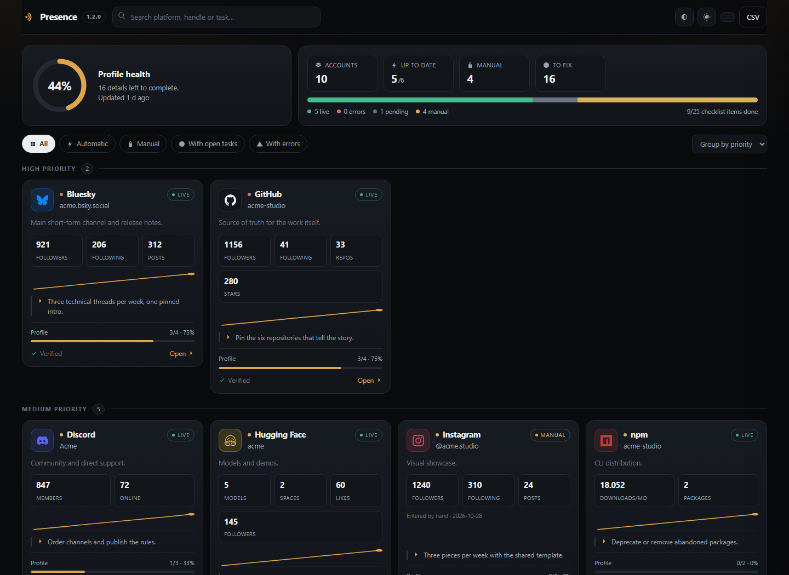
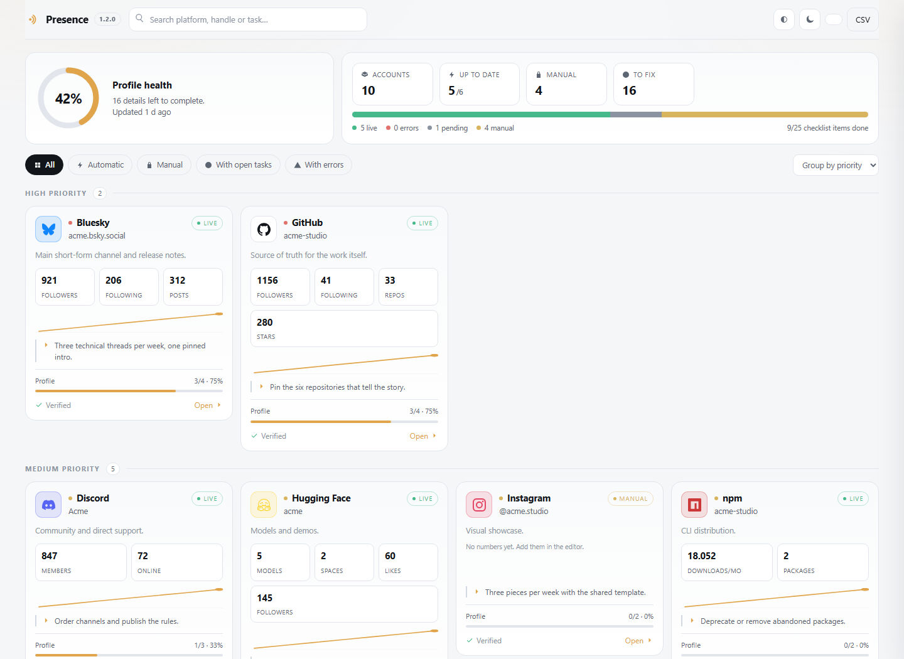
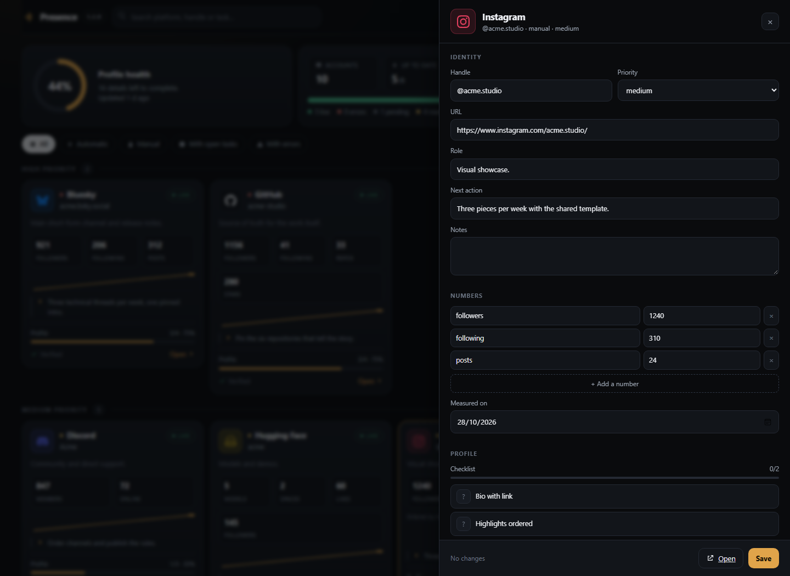

<div align="center">
  <picture>
    <source media="(prefers-color-scheme: dark)" srcset="assets/branding/logo-white.png">
    
  </picture>

  <h1>Presence</h1>

  <p><strong>Tu presencia social, bajo control.</strong></p>

  <p>Panel local para las cuentas que forman tu presencia pública.<br>
  Un registro, una lista de comprobación por perfil, un solo lugar para los números.<br>
  Sin cuenta, sin telemetría, sin publicar.</p>

  <p><a href="README.md">English</a> · <strong>Español</strong></p>
</div>

<p align="center">
  
  
  
  
  
</p>

---

## Por qué

Nadie pierde el control de su presencia social de golpe. Se pierde despacio: un
handle cambia en un sitio y no en el otro, una bio tiene dos años, una red queda
abandonada sin decidirlo, las métricas viven en cinco paneles distintos y las
herramientas que prometen arreglarlo piden tus credenciales y una cuota mensual.

Presence es lo contrario: **un único archivo local** que describe tus cuentas, una
**lista de comprobación por perfil** para ver qué está realmente configurado y
**lectores** que traen números públicos sin pedir contraseñas.

~~~text
registro  ->  auditoría  ->  lectura  ->  decisión  ->  (publicas tú)
~~~

Nunca publica. Nunca programa. Nunca edita un perfil remoto.

## Qué incluye

| Capacidad | Detalle |
| --- | --- |
| **Un registro** | Handle, URL, categoría, prioridad, rol, próxima acción y notas por red. |
| **Checklist de perfil** | Tres estados: hecho, pendiente, desconocido. Sin progreso falso. |
| **Salud de configuración** | Puntuación 0–100: checklist 70, verificado 10, próxima acción 10, datos 10. |
| **Lectores públicos** | GitHub, Bluesky, npm, Hugging Face, Discord y Mastodon. |
| **Histórico** | Una línea JSON por lectura; deltas y gráficas con puntos reales. |
| **Editor** | Cambiar handles, prioridades y checklists desde el panel. |
| **Copias** | Cada guardado conserva la versión anterior; se mantienen las 20 últimas. |
| **Números manuales** | Escribe seguidores, posts o karma con la fecha de medición. |
| **App de escritorio** | Bandeja de Windows que arranca y detiene el servidor. |
| **CSV** | Exportación de todas las métricas. |

## Arranque rápido

```bash
git clone https://github.com/smouj/presence.git
cd presence
python -m presence init      # crea accounts.json desde el ejemplo
python -m presence check     # valida el esquema
python -m presence serve     # http://127.0.0.1:8770
```

Abre <http://127.0.0.1:8770>, pulsa **Collect** y edita tus cuentas.

Requisitos: Python 3.11 o superior. Nada más. Sin Node, sin Docker, sin compilación.

## App de escritorio

El mismo panel puede vivir en la bandeja de Windows: al abrir la app arranca el
servidor local y **Quit** lo detiene.

```powershell
powershell -ExecutionPolicy Bypass -File desktop\build.ps1 -SourceDir C:\ruta\a\presence
```

Compila con el `csc.exe` incluido en Windows (sin SDK de .NET) y genera
`desktop\bin\Presence.exe`. Cópialo junto a un `presence.desktop.ini` con tu
distro, raíz del workspace, puerto y ruta del CLI.

- El menú de la bandeja tiene **Open Presence**, **Update numbers now**,
  **Open data folder**, **Start with Windows** y **Quit**.
- El panel se abre en una ventana de aplicación de Edge (o el navegador por defecto).
- Cerrar la ventana mantiene la bandeja viva; **Quit** detiene el servidor.
- `Presence.exe --quit` cierra una instancia abierta sin dejar el servidor suelto.

## Capturas

<p align="center">
  <br>
  <sub>Panel en tema oscuro — workspace de demostración con datos inventados.</sub>
</p>

<p align="center">
  
  <br>
  <sub>Tema claro y editor de cuenta.</sub>
</p>

## Configuración

`accounts.json` es la fuente de verdad y está excluido de Git. El repositorio solo
incluye `config/accounts.example.json` con datos inventados.

| Campo | Obligatorio | Notas |
| --- | --- | --- |
| `id` | sí | `[a-z0-9][a-z0-9_-]{0,31}`, único. |
| `name`, `handle`, `url` | sí | `url` debe empezar por `http(s)://`. |
| `tracking` | no | `auto` o `manual` (por defecto `manual`). |
| `collector` | solo auto | Uno de los adaptadores de abajo. |
| `priority` | no | `high`, `medium`, `low`. |
| `checklist` | no | `done` es `true`, `false` o `null` (desconocido). |

## Lectores

| Adaptador | Lee | Necesita |
| --- | --- | --- |
| `github` | Seguidores, siguiendo, repos públicos, estrellas | Handle público |
| `bluesky` | Seguidores, siguiendo, posts | Handle público |
| `npm` | Descargas del último mes por paquete | Lista de paquetes |
| `huggingface` | Modelos, Spaces, likes, seguidores | Autor público |
| `discord` | Miembros aproximados y en línea | URL de invitación |
| `mastodon` | Seguidores, siguiendo, posts | Handle e instancia |

**Manuales por diseño:** X, Instagram, Threads, YouTube, Twitch, Reddit, itch.io,
Product Hunt y Telegram. Leerlas exige API de pago (X), revisión de app (Meta),
aplicación OAuth (YouTube, Twitch, Reddit, Product Hunt) o no existe API (itch.io,
Telegram). Presence guarda lo que escribes y lo marca como manual. No adivina.

## Datos y privacidad

- `accounts.json`, `data.json`, `history.jsonl` y `backups/` se quedan en tu
  equipo y están excluidos de Git.
- El servidor escucha solo en `127.0.0.1`. No tiene autenticación: si lo expones,
  pon delante un proxy que autentique.
- No se guardan credenciales. Los lectores usan endpoints públicos.
- Sin analítica, sin fuentes externas, sin CDN: la interfaz son tres archivos locales.

## Estado del proyecto

**1.0.0, usable hoy.** El registro, los seis lectores, el editor, el histórico y la
exportación CSV están implementados y cubiertos por 38 tests. Falta a propósito:
autenticación, multiusuario, programación de tareas y cualquier escritura en una
red social.

Límites conocidos: las redes manuales necesitan intervención humana; tu red debe
permitir los seis endpoints públicos; la interfaz está solo en inglés.

## Hoja de ruta

- Importadores de formatos habituales (CSV, Notion, Airtable).
- Token opcional para despliegues en LAN.
- Más lectores cuando exista una API gratuita y documentada.
- Resumen semanal en Markdown para un repo o una app de notas.

## Contribuir

Lee [CONTRIBUTING.md](CONTRIBUTING.md). Las reglas son cortas: sin dependencias,
sin código que publique, sin datos inventados y un test por cada lector.

## Licencia

MIT — ver [LICENSE](LICENSE).
