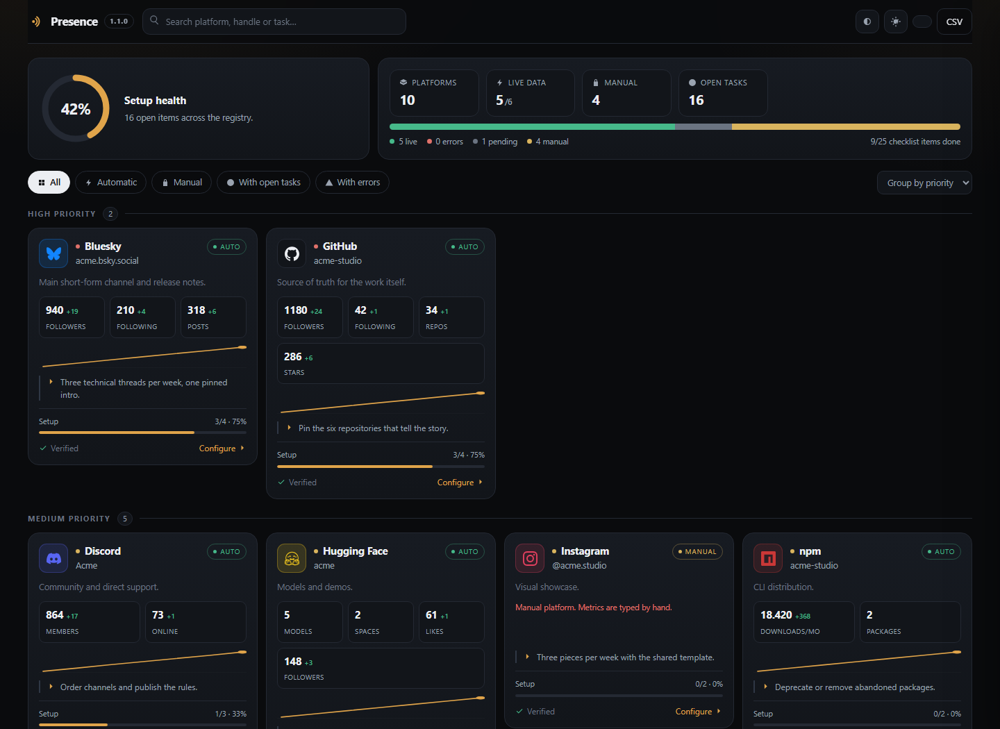
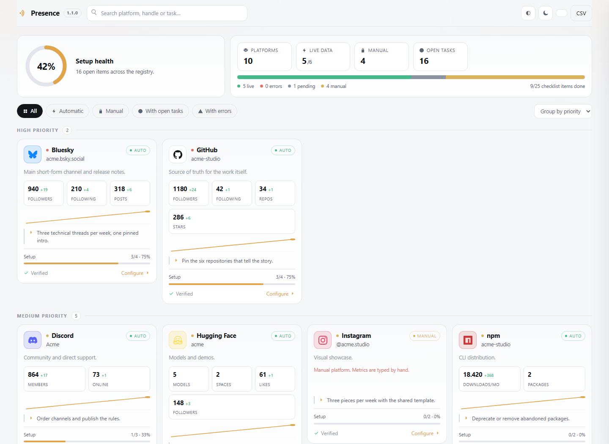
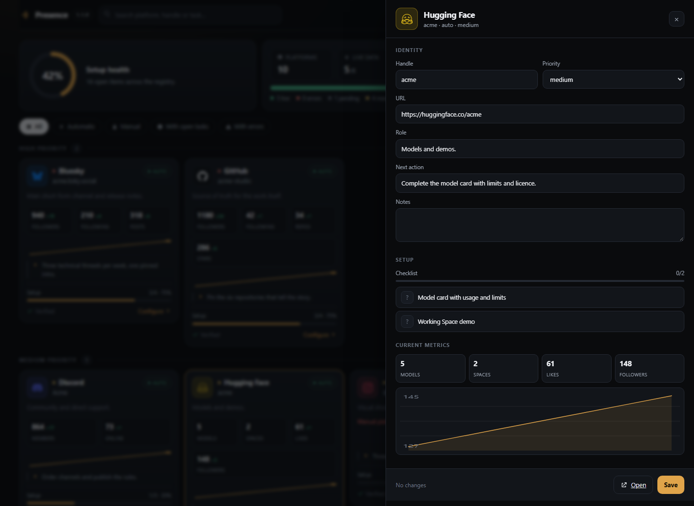

<div align="center">
  <picture>
    <source media="(prefers-color-scheme: dark)" srcset="assets/branding/logo-white.png">
    
  </picture>

  <h1>Presence</h1>

  <p><strong>Your social presence, under your control.</strong></p>

  <p>A local-first control panel for the accounts that make up your public presence.<br>
  One registry, one setup checklist per profile, one place for the numbers.<br>
  No account, no telemetry, no publishing.</p>

  <p><strong>English</strong> · <a href="README.es.md">Español</a></p>
</div>

<p align="center">
  
  
  
  
  
</p>

---

## Why

Most people do not lose control of their social presence in one dramatic moment.
They lose it slowly: a handle changes in one place and not the other, a bio is two
years old, a platform is abandoned without a decision, metrics live in five
different dashboards, and the only tools that promise to fix it want your
credentials and a monthly fee.

Presence is the opposite: a **single local file** that describes your accounts, a
**checklist per profile** so you can see what is actually configured, and
**readers** that pull public numbers without asking for a password.

~~~text
registry  ->  audit  ->  read  ->  decide  ->  (you publish)
~~~

It never publishes. It never schedules. It never edits a remote profile.

## What you get

| Capability | Detail |
| --- | --- |
| **One registry** | Handle, URL, category, priority, role, next action and notes per platform. |
| **Setup checklist** | Three states per item: done, open, unknown. No fake progress. |
| **Setup health** | Deterministic 0–100 score: checklist 70, verified 10, next action 10, live data 10. |
| **Public readers** | GitHub, Bluesky, npm, Hugging Face, Discord and Mastodon. |
| **History** | One JSON line per collection; deltas and charts from real points. |
| **Editor** | Change handles, priorities and checklists from the dashboard. |
| **Backups** | Every save copies the previous config and keeps the last 20. |
| **CSV** | Export every metric for a spreadsheet. |

## Quick start

```bash
git clone https://github.com/smouj/presence.git
cd presence
python -m presence init      # creates accounts.json from the example
python -m presence check     # validates the schema
python -m presence serve     # http://127.0.0.1:8770
```

Then open <http://127.0.0.1:8770>, press **Collect** and edit your accounts.

Requirements: Python 3.11 or newer. Nothing else. No Node, no Docker, no build step.

## Screenshots

<p align="center">
  <br>
  <sub>Dashboard, dark theme — demo workspace with invented data.</sub>
</p>

<p align="center">
  
  <br>
  <sub>Light theme and the account editor.</sub>
</p>

## Configuration

`accounts.json` is the source of truth. It is git-ignored: the repository only
ships `config/accounts.example.json` with invented data.

```json
{
  "schema_version": 1,
  "brand": { "name": "Acme Studio", "handle": "@acme" },
  "platforms": [
    {
      "id": "github",
      "name": "GitHub",
      "handle": "acme-studio",
      "url": "https://github.com/acme-studio",
      "tracking": "auto",
      "collector": "github",
      "priority": "high",
      "role": "Source of truth for the work itself.",
      "next_action": "Pin the six repositories that tell the story.",
      "checklist": [
        { "item": "Profile README published", "done": true },
        { "item": "Pinned repositories curated", "done": false }
      ]
    }
  ]
}
```

| Field | Required | Notes |
| --- | --- | --- |
| `id` | yes | `[a-z0-9][a-z0-9_-]{0,31}`, unique. |
| `name`, `handle`, `url` | yes | `url` must start with `http(s)://`. |
| `tracking` | no | `auto` or `manual` (default `manual`). |
| `collector` | auto only | One of the adapters below. |
| `priority` | no | `high`, `medium`, `low`. |
| `checklist` | no | `done` is `true`, `false` or `null` (unknown). |
| `packages` | npm only | List of npm package names. |
| `instance` | no | Mastodon host when it is not in the URL. |

## Readers

| Adapter | Reads | Needs |
| --- | --- | --- |
| `github` | Followers, following, public repos, total stars | Public handle |
| `bluesky` | Followers, following, posts | Public handle |
| `npm` | Downloads in the last month, per package | Package list |
| `huggingface` | Models, Spaces, likes, followers | Public author |
| `discord` | Approximate members and online count | Invite URL |
| `mastodon` | Followers, following, posts | Handle and instance |

**Manual by design:** X, Instagram, Threads, YouTube, Twitch, Reddit, itch.io,
Product Hunt and Telegram. Reading them requires a paid API (X), an app review
(Meta), an OAuth application (YouTube, Twitch, Reddit, Product Hunt) or there is
simply no API (itch.io, Telegram). For those, Presence stores what you type and
marks it as manual. It does not guess.

## Data and privacy

- `accounts.json`, `data.json`, `history.jsonl` and `backups/` stay on your
  machine and are excluded from Git.
- The server listens on `127.0.0.1` only. There is no authentication layer: put
  it behind an authenticating proxy before exposing it.
- No credentials are stored. Readers use public endpoints.
- No analytics, no fonts, no CDN: the interface is three local files.

## Architecture

~~~text
config/accounts.example.json   template shipped with the repository
accounts.json                  your registry (git-ignored)
presence/models.py             schema, validation, health score
presence/store.py              atomic writes, backups, history, CSV
presence/collectors.py         six public readers, injectable fetch
presence/server.py             JSON API + static files
presence/cli.py                init, check, collect, export, serve
presence/web/                  dashboard: HTML, CSS, JS, no dependencies
~~~ 

API:

| Method | Path | Purpose |
| --- | --- | --- |
| `GET` | `/api/health` | Version and uptime. |
| `GET` | `/api/state` | Accounts, metrics, history and counts. |
| `GET` | `/api/config` | Current registry. |
| `PUT` | `/api/config` | Validate, back up and save the registry. |
| `POST` | `/api/collect` | Run the readers. |
| `GET` | `/api/export.csv` | Metrics as CSV. |

## Project status

**1.0.0, usable today.** The registry, the six readers, the editor, the history
and the CSV export are implemented and covered by 38 tests. What is deliberately
missing: authentication, multi-user support, scheduling, and any write access to
a social platform.

Known limits: manual platforms need human input; the proxy or network of your
environment must allow the six public endpoints; the interface is English only.

## Roadmap

- Importers for common formats (CSV, Notion, Airtable).
- Optional bearer token for LAN deployments.
- More readers when a free, documented API exists.
- Weekly digest export (Markdown) for a repo or a notes app.

## Contributing

Read [CONTRIBUTING.md](CONTRIBUTING.md). The rules are short: no dependencies, no
publishing code, no invented data, tests for every reader.

## License

MIT — see [LICENSE](LICENSE).
